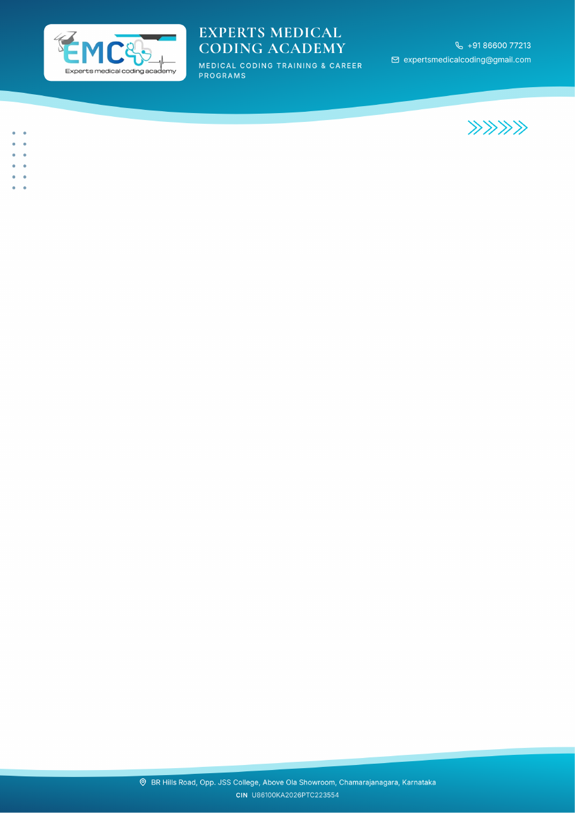

# Experts Medical Coding Academy: letterhead

Made with `EMCA-Letterhead-Studio.html` (repository root), using the details from the academy's introductory-session flyer.

| File | Use it for |
|---|---|
| `EMCA_Letterhead.docx` | Writing letters in Word. Type in the page body; the letterhead repeats on every page. |
| `EMCA_Letterhead.pdf` | Printing blank letterhead sheets. A4, one page. |

**Details on the letterhead**
- Phone: +91 86600 77213
- Email: expertsmedicalcoding@gmail.com
- Address: BR Hills Road, Opp. JSS College, Above Ola Showroom, Chamarajanagara, Karnataka
- CIN: U86100KA2026PTC223554 (footer)

To change anything (PIN code, website, Facebook or Instagram links, a different design), open `EMCA-Letterhead-Studio.html`, edit the form, and download again.

The logo is cropped from the flyer, so it is small. For sharper print, upload the original logo file in the tool under **Logo → Replace**.
